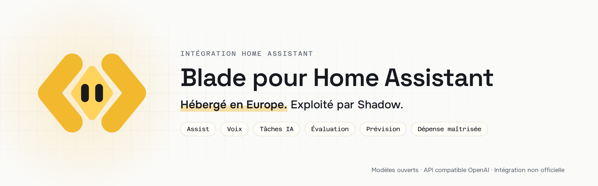
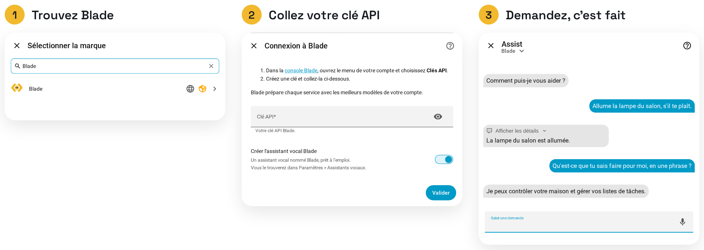
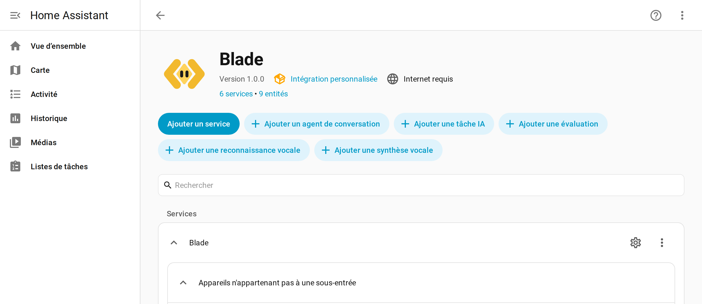
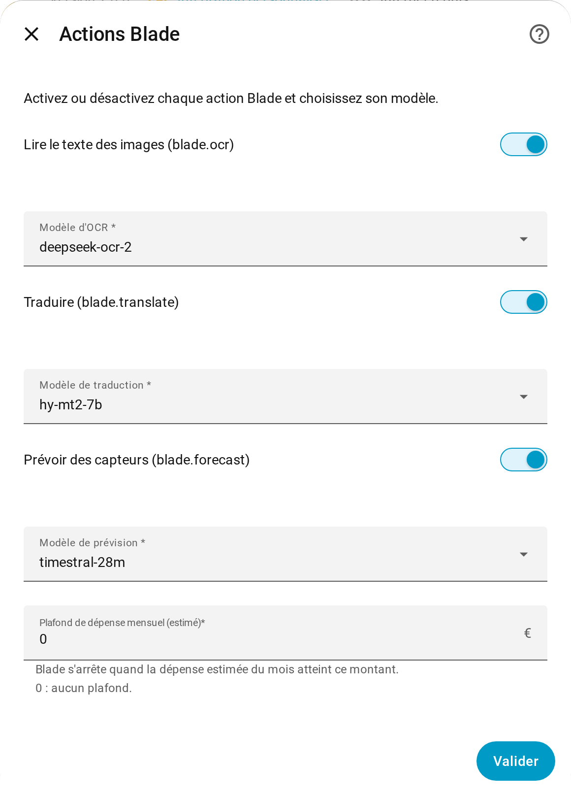

<p align="center">
  <picture>
    <source media="(prefers-color-scheme: dark)" srcset="docs/images/banner-fr-dark.png">
    
  </picture>
</p>

<p align="center">
  <a href="#installation"></a>
  
  
  <a href="https://github.com/TazzerMAN/ha-blade/actions/workflows/tests.yml"></a>
  
  <a href="https://scorecard.dev/viewer/?uri=github.com/TazzerMAN/ha-blade"></a>
  <a href="LICENSE"></a>
</p>

<p align="center"><a href="README.md">English version</a></p>

Branchez Home Assistant sur [Blade](https://blade.sh) et ses modèles ouverts : votre assistant vocal, vos tâches IA et vos automatisations tournent alors sur des GPU que Shadow exploite en Europe. L'API est compatible OpenAI.

- **Une clé suffit.** Vous collez votre clé API Blade ; l'intégration retient les meilleurs modèles de votre compte et vous prépare un assistant vocal.
- **Il parle sans attendre.** La réponse s'affiche au fil de l'eau, et la voix, en français comme en anglais, démarre avant même qu'elle soit terminée.
- **Vous gardez la main.** Chaque fonction est un service distinct, que vous ajoutez, réglez ou supprimez. Les outils web payants restent désactivés tant que vous ne les activez pas.
- **Vous savez ce que vous dépensez.** Sans abonnement : vous ne payez que ce que vous utilisez. Home Assistant affiche ce que Blade vous coûte et peut tout arrêter à un plafond mensuel.

> Intégration non officielle, indépendante de Blade et de Shadow.

## Installée en une minute

<picture>
  <source media="(prefers-color-scheme: dark)" srcset="docs/images/steps-fr-dark.png">
  
</picture>

<details>
<summary>D'autres écrans</summary>





</details>

## Ce que contient l'intégration

Chaque fonction est un service distinct, que vous ajoutez, reconfigurez ou supprimez depuis la page de l'intégration. Chacune a son propre modèle, choisi dans le catalogue de votre compte Blade. Ce catalogue est relu toutes les heures : un nouveau modèle apparaît sans que vous ayez à mettre l'intégration à jour.

| Fonction | Rôle | Modèle par défaut |
|---|---|---|
| Agent de conversation | Agent Assist : il pilote la maison, répond au fil de l'eau et sait raisonner. En option : recherche web (facturée par Blade à chaque recherche), lecture de pages web et exécution de code Python. | `qwen3.6-35b-a3b` |
| Tâche IA | `ai_task.generate_data`, avec réponse structurée et captures de caméra ou photos en pièces jointes, et `ai_task.generate_image`. | `gemma-4-31b`, `flux-2-klein` |
| Évaluation | `ai_task.evaluate` : questions par oui ou non, à choix ou à note, avec des probabilités calibrées, en un seul appel rapide. | `clef-flash` |
| Reconnaissance vocale | Transcrit la voix pour les assistants Assist. Les modèles Gladia passent devant dès que votre compte y a accès. | `voxtral-mini-3b` |
| Synthèse vocale | Voix française et anglaise. En streaming, elle commence à parler pendant que l'agent écrit encore. | `kyutai-tts-1.6b-en-fr` |

Vous utilisiez Extended OpenAI Conversation ? Collez votre YAML `functions` dans le champ **Fonctions personnalisées** de l'agent (types `native` execute_service, `script` et `template`) et reprenez votre prompt tel quel : `exposed_entities` y fonctionne de la même façon. Les appels de service natifs se limitent aux entités exposées à Assist.

Trois actions, à activer une à une dans les options de l'intégration :

- `blade.ocr` : extrait le texte d'une capture de caméra ou d'une image, mis en forme en Markdown.
- `blade.translate` : traduit un texte avec un modèle spécialisé.
- `blade.forecast` : prévoit les prochaines heures d'un capteur d'après ses statistiques long terme, avec une fourchette probable.

Pour aller plus loin, des idées et des recettes prêtes à adapter : [Idées et recettes](docs/use-cases.fr.md).

## Suivre vos dépenses

Home Assistant estime le coût de chaque appel à partir de la consommation que renvoie Blade et des prix de son catalogue.

- **Blade Coût estimé aujourd'hui** et **Blade Coût estimé ce mois-ci**, en euros et détaillés par service, et **Blade Jetons ce mois-ci**, entrée en cache comprise. Les prix suivent le catalogue, relu toutes les heures. L'entrée en cache est comptée au prix plein : l'estimation pèche donc plutôt par excès.
- **Plafond de dépense mensuel**, dans les options de l'intégration : une fois l'estimation arrivée au plafond, plus aucun appel ne part vers Blade jusqu'au mois suivant, et une réparation vous en explique la raison.
- **Blade État du compte** : si Blade refuse une requête (solde épuisé, facture impayée ou plafond du compte atteint), le capteur le signale et une réparation vous indique quoi faire.

Le montant réellement facturé se trouve dans la [console Blade](https://console.blade.sh).

## Installation

Home Assistant 2026.11 ou plus récent est nécessaire.

1. Dans le **Marketplace** de Home Assistant, cherchez **Blade** et installez-le. Tant que Blade n'apparaît pas dans le catalogue, ajoutez ce dépôt comme dépôt personnalisé, de type intégration (il faut pour cela connecter le Marketplace à GitHub).
2. Redémarrez Home Assistant.
3. Dans **Paramètres > Appareils et services > Ajouter une intégration**, choisissez **Blade** et collez une clé API créée dans la [console Blade](https://console.blade.sh) (menu du compte, puis **Clés API**). La clé doit avoir les droits **Exécuter l'inférence** et **Lire l'état des modèles**. Cochez aussi **Lire l'usage** : la même clé servira quand l'intégration affichera le solde du compte.

Et c'est tout. Blade parcourt le catalogue de votre compte et crée un agent de conversation, une tâche IA, une évaluation, une reconnaissance et une synthèse vocales, chacun avec le meilleur modèle disponible (signalé par ★ dans les listes). Si votre compte n'a aucun modèle pour l'un de ces services, celui-ci n'est tout simplement pas créé. Supprimez ceux qui ne vous servent pas.

Si vous laissez cochée la case **Créer l'assistant vocal Blade** (c'est le cas par défaut), vous trouverez dans **Paramètres > Assistants vocaux** un assistant nommé **Blade**, déjà relié à l'agent, à la reconnaissance et à la synthèse vocales Blade. Sélectionnez-le sur votre satellite vocal, et parlez-lui.

## Exemples

Savoir qui est à la porte :

```yaml
action: ai_task.generate_data
data:
  task_name: Porte d'entrée
  entity_id: ai_task.blade_ai_task
  instructions: Décris en une phrase qui se trouve devant la porte.
  attachments:
    media_content_id: media-source://camera/camera.porte_entree
    media_content_type: image/jpeg
response_variable: resultat
```

Ne prévenir que si cela en vaut la peine :

```yaml
action: ai_task.evaluate
data:
  task_name: Garage
  entity_id: ai_task.blade_evaluation
  state: "Porte du garage ouverte depuis {{ relative_time(states.cover.garage.last_changed) }}, il est {{ now().strftime('%H:%M') }}."
  questions:
    prevenir:
      type: noul
      instructions: Faut-il prévenir les habitants ?
response_variable: resultat
```

Prévoir la consommation de demain :

```yaml
action: blade.forecast
data:
  entity_id: sensor.puissance_maison
  history_hours: 336
  horizon_hours: 24
response_variable: prevision
```

## Coûts

Blade facture au jeton, à la minute d'audio ou à l'image, selon les tarifs publiés sur [blade.sh](https://blade.sh/models/pricing/). La recherche web est facturée en plus, à chaque recherche ; comme la lecture de pages web et l'exécution de code, elle est désactivée par défaut.

## Configuration

**À l'installation** : la clé API, et la création ou non de l'assistant vocal Blade.

**Pour chaque service** (roue dentée sur sa ligne) :

| Service | Réglages |
|---|---|
| Agent de conversation | Modèle ; instructions (les templates sont acceptés) ; API de Home Assistant autorisées ; fonctions personnalisées ; recherche web, lecture de pages web et code Python. En décochant *Réglages recommandés du modèle* : température, longueur maximale de la réponse et effort de raisonnement |
| Tâche IA | Modèle ; génération d'images, avec son modèle et la taille des images |
| Évaluation | Modèle de décision |
| Reconnaissance vocale | Modèle ; contexte |
| Synthèse vocale | Modèle ; voix ; streaming |

**Options de l'intégration** (roue dentée sur la ligne Blade) : chaque action, activée ou non, avec son modèle, et le plafond de dépense mensuel.

## Mise à jour des données

Rien n'interroge Blade en boucle. Les services n'appellent Blade que lorsque Home Assistant en a besoin, et les capteurs de dépense se mettent à jour après chaque appel. Le catalogue des modèles est lu au démarrage, puis relu toutes les heures.

## Dépannage

- **« Blade a refusé cette clé API »** : créez une nouvelle clé dans la console, avec les droits *Exécuter l'inférence* et *Lire l'état des modèles*, puis choisissez **Reconfigurer** sur l'intégration.
- **Un service manque après l'installation** : votre compte n'a aucun modèle de ce type. Vous pourrez l'ajouter plus tard depuis la page de l'intégration.
- **L'assistant répond par écrit mais ne parle pas** : la langue de l'assistant vocal doit faire partie des langues de la voix choisie (Kyutai : français et anglais ; Kokoro : anglais).
- **Blade ne répond plus** : regardez le capteur **Blade État du compte** et **Paramètres > Réparations** ; le solde, une facture ou un plafond demande votre attention.
- **Autre problème** : téléchargez les diagnostics depuis la page de l'intégration (la clé API en est retirée) et ouvrez un ticket.

## Limites connues

- Les évaluations ne lisent que du texte : elles refusent les pièces jointes.
- Home Assistant ne passe en voix continue qu'à partir de 60 caractères de réponse ; en dessous, la réponse est lue une fois complète.
- Les voix Kokoro ne parlent qu'anglais.

## Désinstallation

Supprimez l'intégration dans **Paramètres > Appareils et services** : ses services, ses entités et l'historique de dépense enregistré disparaissent avec elle. Si elle a créé l'assistant vocal Blade, supprimez-le dans **Paramètres > Assistants vocaux**. Désinstallez enfin Blade depuis le Marketplace, puis redémarrez Home Assistant.

## Développement

```sh
uv sync
uv run pytest
uv run ruff check custom_components tests
uv run mypy custom_components
```

Les logos sont générés depuis `assets/brand` par `scripts/render_brand.sh`, et les images de ce README par `scripts/readme/render.sh`.

## Licence

Apache-2.0
