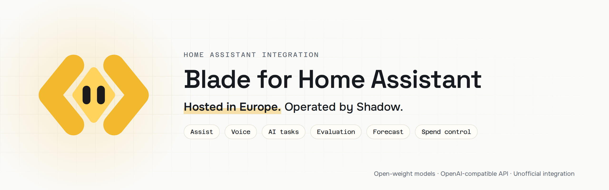
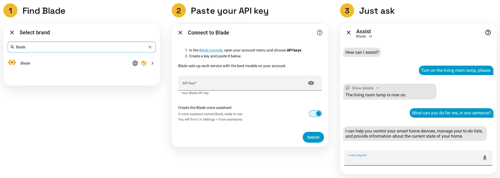
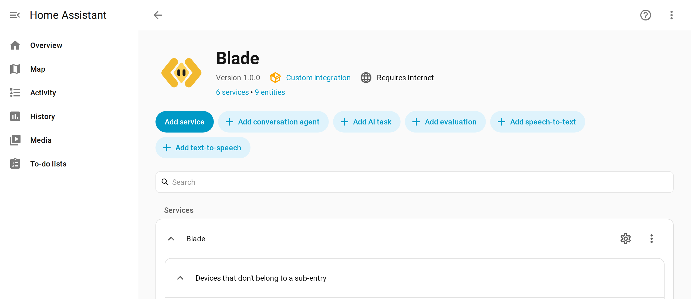
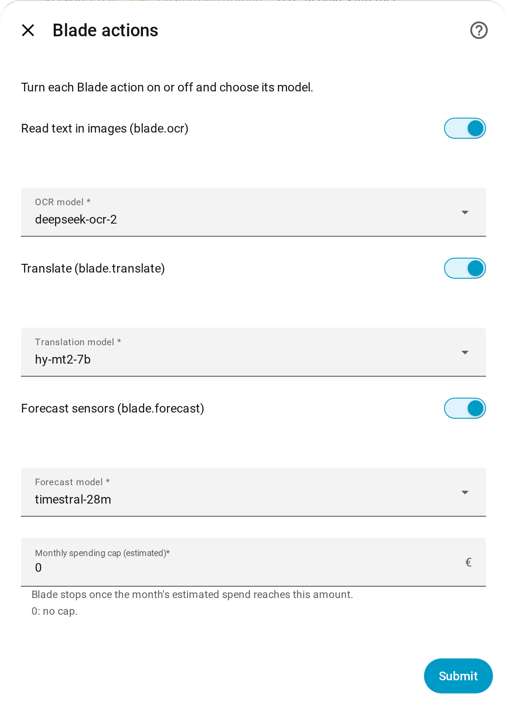

<p align="center">
  <picture>
    <source media="(prefers-color-scheme: dark)" srcset="docs/images/banner-en-dark.png">
    
  </picture>
</p>

<p align="center">
  <a href="#installation"></a>
  
  
  <a href="https://github.com/TazzerMAN/ha-blade/actions/workflows/tests.yml"></a>
  
  <a href="https://scorecard.dev/viewer/?uri=github.com/TazzerMAN/ha-blade"></a>
  <a href="LICENSE"></a>
</p>

<p align="center"><a href="README.fr.md">Version française</a></p>

Bring [Blade](https://blade.sh)'s open-weight models to every part of Home Assistant that speaks AI: your voice assistant, AI tasks and automations. Inference runs on Shadow-operated GPUs in Europe, through an OpenAI-compatible API.

- **One key, everything set up.** Paste a Blade API key; the best models of your account are picked for you, and a ready-to-use Blade voice assistant is created.
- **Talks while it thinks.** Streamed answers, and French and English speech that starts before the answer is finished.
- **Your rules.** Every feature is its own service you add, tune or remove. Paid web tools stay off until you turn them on.
- **A bill you can read.** No subscription: you pay for what you use. Home Assistant shows what Blade costs you, and can stop at a monthly cap.

> Unofficial integration, not affiliated with Blade or Shadow.

## A minute to set up

<picture>
  <source media="(prefers-color-scheme: dark)" srcset="docs/images/steps-en-dark.png">
  
</picture>

<details>
<summary>More screens</summary>





</details>

## What you get

Every feature is a separate service you add, reconfigure or delete on the integration page. Each one picks its own model from your live Blade catalog, so new models show up without an update.

| Feature | What it does | Default model |
|---|---|---|
| Conversation agent | Assist agent that controls your home, streams its answers, and can reason. Optional: web search (billed per search by Blade), web page reading, Python code execution. | `qwen3.6-35b-a3b` |
| AI task | `ai_task.generate_data` with structured output, camera snapshots and photos as input, and `ai_task.generate_image`. | `gemma-4-31b`, `flux-2-klein` |
| Evaluation | `ai_task.evaluate`: yes/no, choice and score questions with calibrated probabilities, in one fast call. | `clef-flash` |
| Speech-to-text | Transcription for Assist pipelines. Gladia models take over as soon as your account has them. | `voxtral-mini-3b` |
| Text-to-speech | French and English voices; with streaming on, it starts speaking while the agent is still writing. | `kyutai-tts-1.6b-en-fr` |

Coming from Extended OpenAI Conversation? Paste your `functions` YAML in the agent's **Custom functions** field (types `native` execute_service, `script` and `template`), and keep your prompt: `exposed_entities` works as there. Native service calls only reach entities exposed to Assist.

Actions (switch each one on or off in the integration options):

- `blade.ocr`: reads the text of a camera snapshot or an image file and returns Markdown.
- `blade.translate`: translates a text with a dedicated translation model.
- `blade.forecast`: predicts the next hours of a sensor from its long-term statistics, with a likely range.

More ideas, with ready-to-adapt recipes: [Ideas and recipes](docs/use-cases.md).

## Spend and account

Home Assistant estimates what each call costs from the usage Blade reports and the catalog prices:

- **Blade Estimated cost today** and **Blade Estimated cost this month** (euros, broken down by service), **Blade Tokens this month** (including cached input). Prices follow the catalog, refreshed every hour; cached input is counted at full price, so the estimate is an upper bound.
- **Monthly spending cap** in the integration options: once the estimate reaches it, Blade calls pause until next month and a repair tells you why.
- **Blade Account status**: when Blade refuses a request because the balance is used up, an invoice is unpaid or its own spending cap is reached, the sensor says so and a repair explains what to do.

Your real bill is always in the [Blade console](https://console.blade.sh).

## Installation

Requires Home Assistant 2026.11 or later.

<a href="https://my.home-assistant.io/redirect/marketplace_repository/?owner=TazzerMAN&repository=ha-blade&category=integration"></a>

1. In the Home Assistant **Marketplace**, search for **Blade** and install it, or open it straight away with the button above.
2. Restart Home Assistant.
3. Go to **Settings > Devices & services > Add integration > Blade** and paste an API key from the [Blade console](https://console.blade.sh) (account menu > **API keys**). The key needs **Run inference** and **Read model status**. Also tick **Read usage**: the same key will keep working when the integration shows the account balance.

That's all. Blade reads your account's catalog and sets up a conversation agent, an AI task, an evaluation, a speech-to-text and a text-to-speech service with the best models your account offers (marked ★ in the model lists). A service your account has no model for is simply not created. Delete the ones you don't need.

With **Create the Blade voice assistant** ticked (the default), a voice assistant named **Blade** is ready in **Settings > Voice assistants**, wired to the Blade agent, speech-to-text and text-to-speech. Pick it on your voice satellite and talk.

## Examples

Describe who is at the door:

```yaml
action: ai_task.generate_data
data:
  task_name: Front door
  entity_id: ai_task.blade_ai_task
  instructions: Describe in one sentence who is at the door.
  attachments:
    media_content_id: media-source://camera/camera.front_door
    media_content_type: image/jpeg
response_variable: result
```

Decide whether a notification is worth sending:

```yaml
action: ai_task.evaluate
data:
  task_name: Garage
  entity_id: ai_task.blade_evaluation
  state: "Garage door open for {{ relative_time(states.cover.garage.last_changed) }}, it is {{ now().strftime('%H:%M') }}."
  questions:
    notify:
      type: noul
      instructions: Should the household be warned?
response_variable: result
```

Forecast tomorrow's consumption:

```yaml
action: blade.forecast
data:
  entity_id: sensor.house_power
  history_hours: 336
  horizon_hours: 24
response_variable: forecast
```

## Costs

Blade bills per token, per audio minute or per image, at prices listed on [blade.sh](https://blade.sh/models/pricing/). Web search is billed per search on top of that; it is off by default, like web page reading and code execution.

## Configuration

**At setup:** the API key, and whether to create the Blade voice assistant.

**Each service** (gear icon on its row):

| Service | Settings |
|---|---|
| Conversation agent | Model, instructions (templates allowed), Home Assistant APIs it may use, custom functions, web search, web page reading, Python code, and, when *Recommended model settings* is off, temperature, maximum answer length and reasoning effort |
| AI task | Model, image generation on or off, image model and size |
| Evaluation | Decision model |
| Speech-to-text | Model, context prompt |
| Text-to-speech | Model, voice, streaming |

**Integration options** (gear icon on the Blade row): each action on or off with its model, and the monthly spending cap.

## Data updates

Nothing is polled. Services call Blade when Home Assistant asks them to, and the spend sensors update after each call. The model catalog is read at startup, then refreshed every hour.

## Troubleshooting

- **"Blade rejected the API key"**: create a new key in the console with *Run inference* and *Read model status*, then use **Reconfigure** on the integration.
- **A service is missing after setup**: your account has no model of that kind; add the service later from the integration page once it has.
- **The voice assistant answers but does not speak, or speech fails**: check that the pipeline language matches a language of the chosen voice (Kyutai: French and English; Kokoro: English).
- **Blade calls stopped**: look at **Blade Account status** and at **Settings > Repairs**; either the balance, an invoice or a spending cap needs attention.
- **Something else**: download the diagnostics from the integration page (the API key is removed) and open an issue.

## Known limitations

- Evaluations read text only; attachments are rejected.
- Home Assistant starts streamed speech only after 60 characters of answer; shorter answers are spoken once complete.
- Kokoro voices speak English only.

## Removal

Delete the integration from **Settings > Devices & services**: its services, entities and stored spend figures go with it. If you let it create the Blade voice assistant, delete that one in **Settings > Voice assistants**. Then uninstall Blade from the Marketplace and restart Home Assistant.

## Development

```sh
uv sync
uv run pytest
uv run ruff check custom_components tests
uv run mypy custom_components
```

Brand images are rendered from `assets/brand` with `scripts/render_brand.sh`, and the images of this README with `scripts/readme/render.sh`.

## License

Apache-2.0
